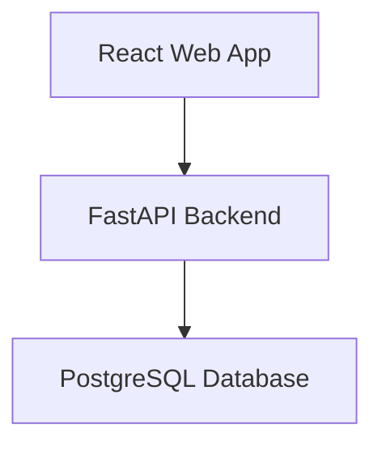
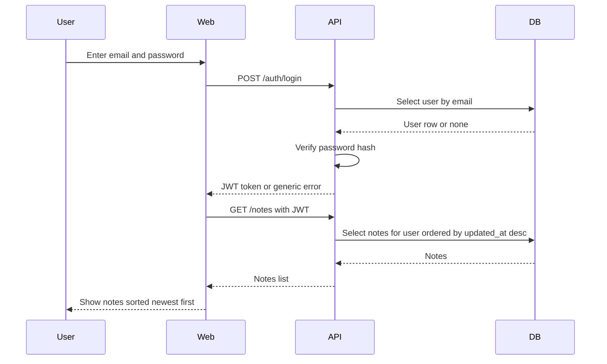
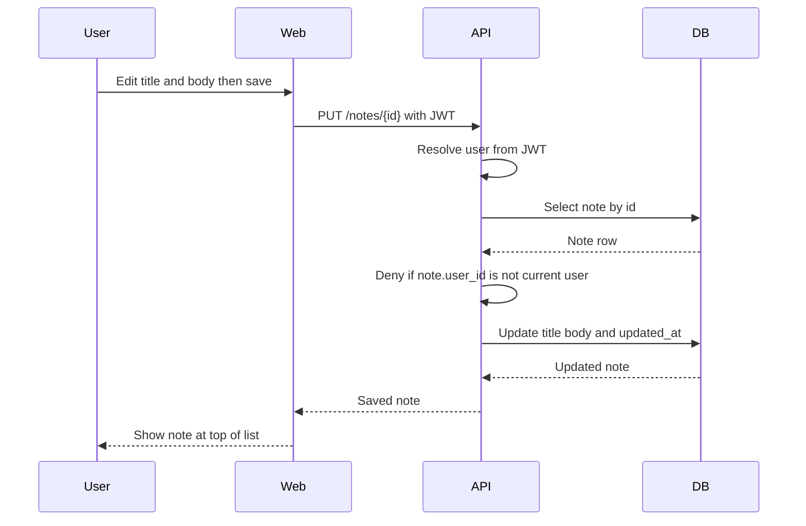
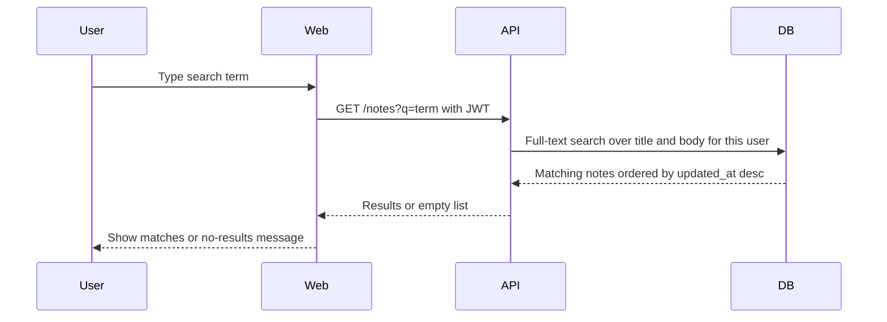
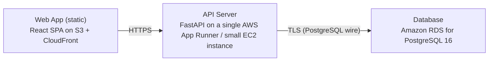

# Architecture

> Maintained by QuorQ AI SDLC. Text between `sdlc:auto` markers is regenerated; anything outside them is yours and is kept.

<!-- sdlc:auto:start narrative -->
## Overview

### ARCH-GAP · draft

No architecture-phase input has been provided for this project.

- ⚠ Architecture phase has not started: no system design, data model, API design, or deployment topology has been recorded, beyond the technology stack named in the requirements phase (FastAPI, AWS, PostgreSQL 16, React 19).
<!-- sdlc:auto:end narrative -->

<!-- sdlc:auto:start building-blocks -->
## Building Block View

| ID | Name | Technology | Responsibility | Depends on |
|---|---|---|---|---|
| web | React Web App | React 19 | Responsive SPA for registration, sign-in/out, notes list sorted by most-recent-edit, search box, and the note editor. Guards note routes so unauthenticated users are redirected to sign-in. | api |
| api | FastAPI Backend | FastAPI 0.115 | REST API for auth (register, login, logout) and note CRUD + search. Issues/validates JWTs, hashes passwords, and enforces per-user ownership on every note operation. | db |
| db | PostgreSQL Database | PostgreSQL 16 | Stores user accounts and notes. Provides full-text search over note titles and bodies and ordering by last-edited timestamp. | — |

<!-- sdlc:auto:end building-blocks -->

<!-- sdlc:auto:start runtime -->
## Runtime View

### Sign in and load notes

User submits email and password. The API verifies credentials against the hashed password, returns a JWT on success or a single generic invalid-credentials message on failure (NFR-002). The SPA stores the token and loads the user's notes.

- **Components:** web, api, db
- **Modules:** auth_router, auth_service, security, user_repository
- **Key functions:** login(credentials), verify_password(plain, hashed), create_access_token(user_id), get_user_by_email(email)

### Create or edit a note with ownership enforcement

An authenticated user saves a note. The API resolves the user from the JWT, writes the note bound to that user_id, and sets the edited timestamp. On edit, it first checks the note belongs to the requester and denies otherwise without revealing content (NFR-001).

- **Components:** web, api, db
- **Modules:** notes_router, notes_service, auth_dependency, note_repository
- **Key functions:** create_note(user_id, title, body), update_note(user_id, note_id, title, body), get_current_user(token), assert_owner(user_id, note)

### Search my notes

User types a term. The API runs a PostgreSQL full-text query scoped to the user's notes across title and body, ordered by most recent edit, and returns matches or an empty set for the no-results message.

- **Components:** web, api, db
- **Modules:** notes_router, notes_service, note_repository
- **Key functions:** search_notes(user_id, term)

<!-- sdlc:auto:end runtime -->

<!-- sdlc:auto:start deployment-view -->
## Deployment View

| Name | Service | Runtime | Scaling | Environment |
|---|---|---|---|---|
| Web App (static) | React SPA on S3 + CloudFront | Static assets | CDN-served, single small distribution | dev |
| API Server | FastAPI on a single AWS App Runner / small EC2 instance | Python 3.12 / Uvicorn | Single instance (individual-scale, NFR-006) | dev |
| Database | Amazon RDS for PostgreSQL 16 | PostgreSQL 16 | Single small instance, encrypted storage | dev |

| Source | Target | Protocol |
|---|---|---|
| Web App (static) | API Server | HTTPS |
| API Server | Database | TLS (PostgreSQL wire) |

<!-- sdlc:auto:end deployment-view -->

<!-- sdlc:auto:start decisions -->
## Architecture Decisions

| Layer | Choice | ADR |
|---|---|---|
| Frontend | React 19 | [ADR-0001](adr/frontend.md) |
| Backend | FastAPI 0.115 | [ADR-0002](adr/backend.md) |
| Database | PostgreSQL 16 | [ADR-0003](adr/database.md) |
| Cloud | AWS | [ADR-0004](adr/cloud.md) |
<!-- sdlc:auto:end decisions -->

<!-- sdlc:auto:start links -->
## Related Documents

- [Data Model](data-model.md)
- [API Specification](api/openapi.yaml)
- [Architecture Decision Records](adr/README.md)
<!-- sdlc:auto:end links -->
