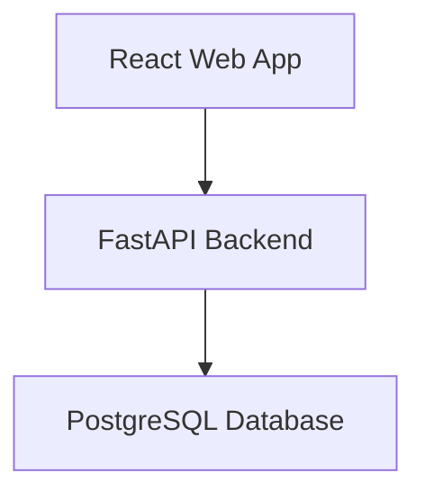
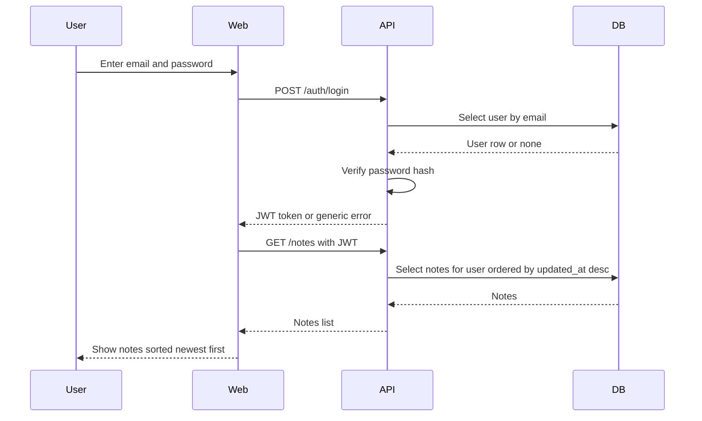
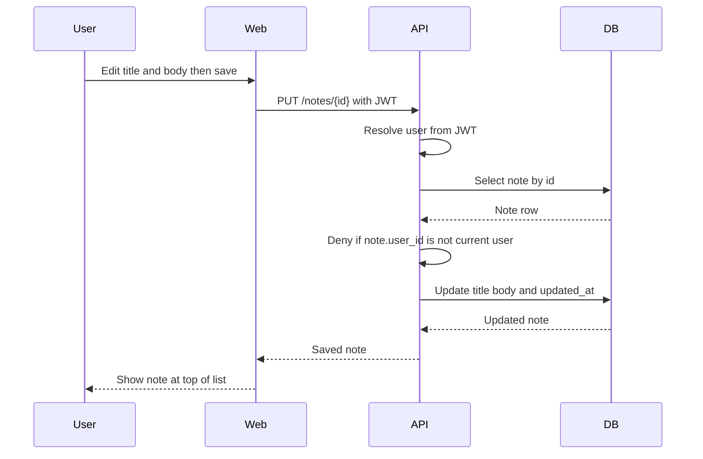
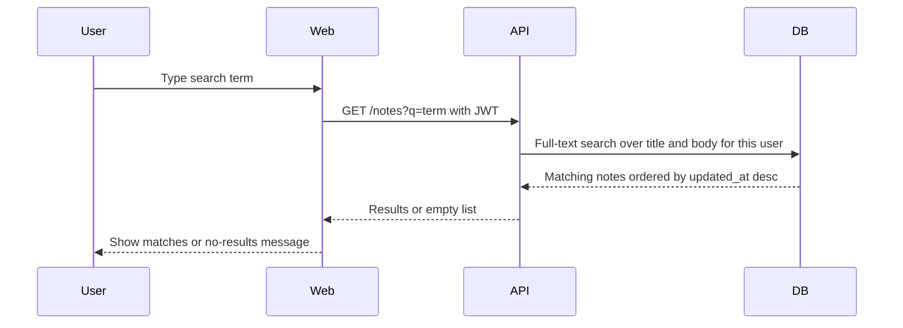
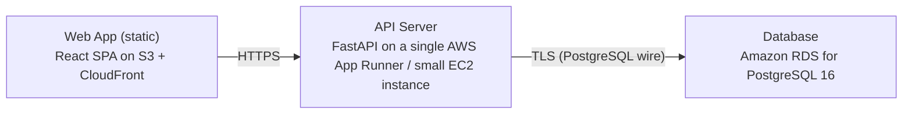

# Architecture

> Maintained by QuorQ AI SDLC. Text between `sdlc:auto` markers is regenerated; anything outside them is yours and is kept.

<!-- sdlc:auto:start narrative -->
## Overview

### ARCH-SUMMARY · approved · source: architecture:summary

Lightweight, single-tenant-per-user notepad: responsive React 19 SPA, FastAPI 0.115 REST API, PostgreSQL 16 database, hosted on AWS.

Approved v1 architecture. Users register and sign in with email/password using a JWT session, then create, edit, delete, list and search their own plain-text notes. Search over titles and bodies uses PostgreSQL's built-in full-text search (no separate search service needed). Every note endpoint enforces ownership checks so notes remain strictly private to their owner.

- ⚠ No requirements-phase documentation was supplied alongside this architecture input, so it is not possible to confirm which of the known requirement keys (US-001 through US-009, US-011) this design fully satisfies.

### ARCH-COMP-WEB · approved · source: architecture:components.web

React 19 single-page web app providing registration, sign-in/out, notes list, search box, and note editor.

Component 'web': Responsive SPA built on React 19. Displays the notes list sorted by most-recent-edit, a search box, and a note editor. Guards note routes so unauthenticated users are redirected to sign-in.

**Related:** NFR-004, NFR-005

### ARCH-COMP-API · approved · source: architecture:components.api

FastAPI 0.115 backend exposing auth and note CRUD/search endpoints.

Component 'api': REST API for auth (register, login, logout) and note CRUD + search. Issues and validates JWTs, hashes passwords, and enforces per-user ownership on every note operation.

**Related:** NFR-001, NFR-002

### ARCH-COMP-DB · approved · source: architecture:components.db

PostgreSQL 16 database storing user accounts and notes with built-in full-text search.

Component 'db': Stores user accounts and notes. Provides full-text search over note titles and bodies and ordering by last-edited timestamp.

**Related:** US-010

### ARCH-CP-SIGNIN · approved · source: architecture:critical_paths.sign_in_and_load_notes

Sign-in flow: credentials verified against hashed password, JWT issued, notes loaded into the SPA.

User submits email and password. The API verifies credentials against the hashed password, returning a JWT on success or a single generic invalid-credentials message on failure (satisfies NFR-002, which avoids revealing whether the email or password was wrong). The SPA stores the token and loads the user's notes.

**Related:** NFR-002

- ⚠ No requirement key (e.g. a US-00x) is explicitly cited for login/registration itself in this input, only the NFR-002 security control.

### ARCH-CP-NOTE-CRUD · approved · source: architecture:critical_paths.create_or_edit_note

Create/edit flow enforces per-user ownership before any note is written or modified.

An authenticated user saves a note. The API resolves the user from the JWT, writes the note bound to that user_id, and sets the edited timestamp. On edit, it first checks the note belongs to the requester and denies otherwise without revealing content (satisfies NFR-001).

**Related:** NFR-001

- ⚠ No requirement key is explicitly cited for note creation/editing itself, only the NFR-001 ownership-security control.

### ARCH-CP-SEARCH · approved · source: architecture:critical_paths.search_my_notes

Search flow runs a PostgreSQL full-text query scoped to the signed-in user's own notes.

User types a search term. The API runs a PostgreSQL full-text query scoped to the user's notes across title and body, ordered by most recent edit, and returns matches or an empty set that triggers the no-results message.

**Related:** US-010

### ARCH-ENTITIES · approved · source: architecture:entities

Two entities: users (auth) and notes (content + search index), linked by user_id for ownership enforcement.

users: id, email, password_hash, created_at. notes: id, user_id, title, body, search_tsv, created_at, updated_at. The notes.user_id foreign key underpins per-user ownership checks; search_tsv backs PostgreSQL full-text search over title and body.

**Related:** US-010

### ARCH-ENDPOINTS · approved · source: architecture:endpoints

Eight REST endpoints cover authentication (register/login/logout) and note CRUD plus search.

POST /auth/register - creates account, returns session token; rejects duplicate/missing/malformed email and missing password. POST /auth/login - signs in with email/password, returns JWT or single generic invalid-credentials error (NFR-002). POST /auth/logout - ends session client-side. GET /notes - lists signed-in user's notes ordered by most recently edited; optional q parameter runs full-text search over title and body (US-010). POST /notes - creates a plain-text note owned by the signed-in user. GET /notes/{id} - fetches one of the signed-in user's notes; denied if not owner. PUT /notes/{id} - updates title/body of an owned note and refreshes the edited timestamp; denied if not owner. DELETE /notes/{id} - permanently deletes an owned note; denied if not owner.

**Related:** NFR-001, NFR-002, US-010

### ARCH-DEPLOY · approved · source: architecture:deployment_nodes

Three-tier AWS deployment: static SPA on S3/CloudFront, FastAPI on App Runner/EC2, PostgreSQL on RDS.

Web App (static): React SPA served as static assets via S3 + CloudFront. API Server: FastAPI running on a single AWS App Runner service or small EC2 instance, Python 3.12 / Uvicorn. Database: Amazon RDS for PostgreSQL 16.

- ⚠ No scaling, backup, or availability details (e.g. multi-AZ, autoscaling) are specified for any deployment node.

### ARCH-TECH-FRONTEND · approved · source: architecture:technology_decisions.frontend

Frontend stack approved as React 19 over Vue/Svelte alternatives.

React 19 selected to power the responsive single-page notepad with a live notes list, search box, and note editor, adapting layout across desktop and mobile browsers (NFR-004, NFR-005). Alternatives considered: Vue, Svelte.

**Related:** NFR-004, NFR-005

### ARCH-TECH-BACKEND · approved · source: architecture:technology_decisions.backend

Backend stack approved as FastAPI 0.115 over Flask/Express alternatives.

FastAPI 0.115 selected to implement the small, well-defined set of auth and note-CRUD/search endpoints with request validation and dependency-injected auth guards. Alternatives considered: Flask, Express.

### ARCH-TECH-DATABASE · approved · source: architecture:technology_decisions.database

Database stack approved as PostgreSQL 16 over MySQL/SQLite alternatives.

PostgreSQL 16 selected to store users and notes relationally and to cover title/body search via built-in full-text search (tsvector + GIN), avoiding the need for a separate search service (US-010). Alternatives considered: MySQL, SQLite.

**Related:** US-010

### ARCH-TECH-CLOUD · approved · source: architecture:technology_decisions.cloud

Cloud platform approved as AWS over GCP/Azure alternatives.

AWS selected to host the static SPA (S3/CloudFront), the FastAPI service, and managed PostgreSQL (RDS) cheaply with room to grow, with TLS and encryption at rest for stored credentials and notes. Alternatives considered: GCP, Azure.
<!-- sdlc:auto:end narrative -->

<!-- sdlc:auto:start building-blocks -->
## Building Block View

| ID | Name | Technology | Responsibility | Depends on |
|---|---|---|---|---|
| web | React Web App | React 19 | Responsive SPA for registration, sign-in/out, notes list sorted by most-recent-edit, search box, and the note editor. Guards note routes so unauthenticated users are redirected to sign-in. | api |
| api | FastAPI Backend | FastAPI 0.115 | REST API for auth (register, login, logout) and note CRUD + search. Issues/validates JWTs, hashes passwords, and enforces per-user ownership on every note operation. | db |
| db | PostgreSQL Database | PostgreSQL 16 | Stores user accounts and notes. Provides full-text search over note titles and bodies and ordering by last-edited timestamp. | — |

<!-- sdlc:auto:end building-blocks -->

<!-- sdlc:auto:start runtime -->
## Runtime View

### Sign in and load notes

User submits email and password. The API verifies credentials against the hashed password, returns a JWT on success or a single generic invalid-credentials message on failure (NFR-002). The SPA stores the token and loads the user's notes.

- **Components:** web, api, db
- **Modules:** auth_router, auth_service, security, user_repository
- **Key functions:** login(credentials), verify_password(plain, hashed), create_access_token(user_id), get_user_by_email(email)

### Create or edit a note with ownership enforcement

An authenticated user saves a note. The API resolves the user from the JWT, writes the note bound to that user_id, and sets the edited timestamp. On edit, it first checks the note belongs to the requester and denies otherwise without revealing content (NFR-001).

- **Components:** web, api, db
- **Modules:** notes_router, notes_service, auth_dependency, note_repository
- **Key functions:** create_note(user_id, title, body), update_note(user_id, note_id, title, body), get_current_user(token), assert_owner(user_id, note)

### Search my notes

User types a term. The API runs a PostgreSQL full-text query scoped to the user's notes across title and body, ordered by most recent edit, and returns matches or an empty set for the no-results message.

- **Components:** web, api, db
- **Modules:** notes_router, notes_service, note_repository
- **Key functions:** search_notes(user_id, term)

<!-- sdlc:auto:end runtime -->

<!-- sdlc:auto:start deployment-view -->
## Deployment View

| Name | Service | Runtime | Scaling | Environment |
|---|---|---|---|---|
| Web App (static) | React SPA on S3 + CloudFront | Static assets | CDN-served, single small distribution | dev |
| API Server | FastAPI on a single AWS App Runner / small EC2 instance | Python 3.12 / Uvicorn | Single instance (individual-scale, NFR-006) | dev |
| Database | Amazon RDS for PostgreSQL 16 | PostgreSQL 16 | Single small instance, encrypted storage | dev |

| Source | Target | Protocol |
|---|---|---|
| Web App (static) | API Server | HTTPS |
| API Server | Database | TLS (PostgreSQL wire) |

<!-- sdlc:auto:end deployment-view -->

<!-- sdlc:auto:start decisions -->
## Architecture Decisions

| Layer | Choice | ADR |
|---|---|---|
| Frontend | React 19 | [ADR-0001](adr/frontend.md) |
| Backend | FastAPI 0.115 | [ADR-0002](adr/backend.md) |
| Database | PostgreSQL 16 | [ADR-0003](adr/database.md) |
| Cloud | AWS | [ADR-0004](adr/cloud.md) |
<!-- sdlc:auto:end decisions -->

<!-- sdlc:auto:start links -->
## Related Documents

- [Data Model](data-model.md)
- [API Specification](api/openapi.yaml)
- [Architecture Decision Records](adr/README.md)
<!-- sdlc:auto:end links -->
